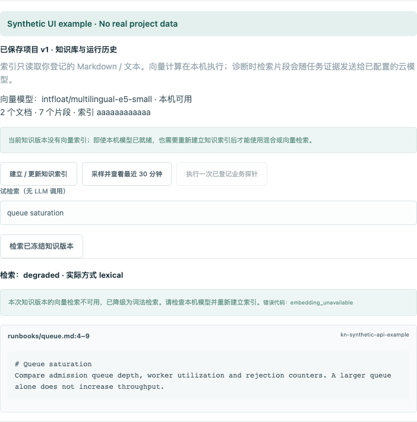

# IncidentDesk

[](https://github.com/Ruyue213/IncidentDesk/actions/workflows/check.yml)

[简体中文](README.zh-CN.md) · [Contributing](CONTRIBUTING.md) · [Security](SECURITY.md) · [Roadmap](ROADMAP.md)

**Local-service performance and availability diagnosis with verifiable evidence and approval-gated actions.**

IncidentDesk connects an agent to a service you own: local logs, health checks, Prometheus metrics, source files, and project runbooks. It collects bounded evidence, links conclusions to captured sources, and pauses for your approval before a registered restart or configuration change. Diagnostic tasks, approvals, and receipts survive browser disconnections and application restarts.

**Status: local engineering beta.** The supported deployment is one operating-system user on one machine, with the web interface bound to `127.0.0.1`. The verified model integration is DeepSeek. This is an operator workbench for local-process services; remote hosts, Docker/Kubernetes management, and shared production deployments are outside the current support contract. A valid citation is evidence provenance, not proof of a correct diagnosis.

## Try it

Requirements: Python **3.12**, macOS or Linux, and `ps`. Windows is unsupported. The release wheel includes the built web interface and explicitly labeled synthetic fixtures; Node.js is needed only when building from source.

Download the wheel and `incidentdesk-constraints.txt` from this repository's **Releases → Assets**, place them together, then install in an isolated environment. Constraints preserve the dependency versions used for release checks:

```sh
python3.12 -m venv .venv
. .venv/bin/activate
python -m pip install --constraint ./incidentdesk-constraints.txt ./incident_desk-0.3.0b1-py3-none-any.whl
incidentdesk doctor
incidentdesk serve
```

Open [the local workbench](http://127.0.0.1:8787). `serve` runs the API and worker until Ctrl+C. The background equivalent is `incidentdesk start`; inspect it with `incidentdesk status`, and stop it with `incidentdesk stop`. Use `--port 8790` to select another loopback port. No model request is made just by opening the application.

For a no-credential installation check, use `incidentdesk serve --offline`. This selects a **scripted test model** for synthetic fixtures. It does not perform offline LLM inference and its reports must not be used as real diagnoses.

### Diagnose your own service

1. Open **Project and model settings**. Register a project root, allowed log paths, and available local health/metrics endpoints. Use the collection probe to inspect actual source availability.
2. Configure the DeepSeek endpoint, model identifier, API key, reasoning option, and spending limits. Saving settings does not validate a provider connection; the explicit tool-call connection test is billable.
3. Create a **real local project** task. State the observed symptom, affected operation, and relevant time window. Open report citations to compare the captured evidence with the model's explanation.
4. Continue a finished diagnosis with a follow-up question. This creates a linked task and collects fresh evidence rather than silently editing the earlier report.
5. To permit managed actions, register the executable/argument array and editable text configuration files first. A proposed action shows the exact frozen parameters or diff. Approval authorizes that specific proposal; it is checked again immediately before execution.

A registered command is an argument array such as `["/absolute/project/bin/server", "--port", "18080"]`. The agent cannot invent an arbitrary shell command. Existing external processes remain readable observations; they are not taken over by process name. Managed execution supports direct, single-process services rather than supervisor/reloader process trees.

The [local OpenAPI reference](http://127.0.0.1:8787/docs) exposes full project registration, knowledge, observation, and task contracts. A service's health check alone cannot establish that its business operation recovered; configure a bounded read-only business probe when available.

## Project knowledge and hybrid RAG

Knowledge is scoped to a registered project and explicitly selected Markdown/text paths. Immutable index generations retain source hashes, line ranges, chunk identities, and the embedding fingerprint. Tasks freeze the selected generation, so an index rebuild does not replace the sources of a running diagnosis.

Retrieval supports lexical BM25, local dense cosine search, and hybrid reciprocal-rank fusion. The optional dense model is `intfloat/multilingual-e5-small`, fixed to revision `fd1525a9fd15316a2d503bf26ab031a61d056e98`, with 384-dimensional normalized vectors and E5 query/passage prefixes. Inference stays local and does not download weights on demand. Install it explicitly:

```sh
python -m pip install --constraint ./incidentdesk-constraints.txt './incident_desk-0.3.0b1-py3-none-any.whl[rag]'
incidentdesk embeddings status
incidentdesk embeddings download
```

The extra installs PyTorch and sentence-transformers; the explicit download retrieves roughly 470 MB of public model files. The model has its own upstream license. This does not make cloud diagnosis offline: selected retrieved passages can still be sent to the configured LLM.

Register `knowledge_paths` and `retrieval_mode` in project settings, save the project, then use its knowledge panel to explicitly build an index and try a query. The same operations are available through `POST /api/projects/{id}/knowledge/index` and `/knowledge/search`. The panel also exposes historical samples and the registered business probe. These checks work independently of the LLM. Missing local embeddings produce a reported degradation; a lexical result must not be described as an active hybrid index. These bounded local indexes target project runbooks, not organization-scale document search.

## What closes the engineering loop

| Concern | Implemented mechanism | Practical boundary |
| --- | --- | --- |
| Evidence | Versioned snapshots and validated quotes; project-scoped knowledge generations | Missing sources and causal uncertainty remain visible |
| Time | Bounded historical health/metrics observations and requested-window coverage | Collection starts when configured; earlier history cannot be reconstructed |
| Execution | Persistent task queue, independent worker, checkpoint/resume, durable event cursor | One local worker and one user |
| Side effects | Frozen previews, approval digests, target/file revalidation, receipts | An interrupted external action can remain uncertain and is not replayed blindly |
| Recovery | Process identity, listener/health checks, optional read-only business probe | A passing probe covers the configured business request only |
| Cost | Persistent reservations, per-task budgets, immutable price/model snapshots | Local estimates are reconciled with returned usage, not a provider invoice |
| Distribution | Bundled UI/resources, installed CLI, clean-venv release checks | Python environment required; no signed desktop installer |

The core stack is Python, FastAPI/Pydantic, Deep Agents/LangGraph, SQLite WAL/checkpoints (with FTS5 for synthetic fixture retrieval), project-scoped BM25, local E5 embeddings, React/TypeScript/Vite, and SSE. The agent's tools enforce scope and approvals outside the model. Adding more agents is not a reliability mechanism by itself.

## State, privacy, and maintenance

Installed state defaults to `~/Library/Application Support/IncidentDesk` on macOS and `${XDG_STATE_HOME:-~/.local/state}/incidentdesk` on Linux. `INCIDENT_DESK_HOME=/absolute/private/path` overrides it. Source checkouts keep their existing `.local` state and root `.env`. Running from another directory never discovers a different `.env`, and installation resources are not used as a writable state directory.

API keys stay in backend-only versioned files with user-only permissions; they are not encrypted. Reports, checkpoints, project locations, and backups can contain sensitive information. Rule-based redaction has limits. See [the complete security boundary](SECURITY.md) before connecting real data.

```sh
incidentdesk stop
incidentdesk backup --archive /absolute/private-backups/incidentdesk.zip
incidentdesk restore --archive /absolute/private-backups/incidentdesk.zip
incidentdesk start
```

Stop managed services as well before restoring. Backups include credentials and databases, exclude process ownership and downloaded embedding weights, and require matching application versions. A nonempty restore target requires `--replace`, which preserves its old state in a separate backup first. External project files need a separate backup. After restoration, explicitly download the pinned embedding model again if needed. Keep archives private; they are not encrypted or signed.

## Build and verify

```sh
uv sync --frozen --extra rag --group dev
npm ci --prefix frontend
npm run build --prefix frontend
uv run --frozen --extra rag incidentdesk doctor
uv run --frozen --extra rag incidentdesk serve
```

Keep `--extra rag` on source `uv run` commands when using local embeddings: uv synchronizes the selected extras and may remove unselected optional packages. To use only lexical retrieval, omit the extra consistently and do not download the embedding model.

```sh
uv run --frozen --extra rag ruff check .
uv run --frozen --extra rag ruff format --check .
uv run --frozen --extra rag pytest -q
npm test --prefix frontend
uv build --out-dir dist
uv export --frozen --all-extras --no-dev --no-emit-project --no-hashes --output-file dist/incidentdesk-constraints.txt
uv run --frozen --extra rag python scripts/check_release.py --wheel dist/incident_desk-0.3.0b1-py3-none-any.whl --constraints dist/incidentdesk-constraints.txt
```

The release check creates a fresh virtual environment and unrelated working directory, installs the wheel, serves its bundled UI, registers a synthetic project, completes a scripted task, and verifies stop/backup/restore. It does not call a provider or touch an existing service. CI performs offline-model checks on Linux and macOS; paid model validation and target-specific service integration are separate, explicit checks. An unexecuted CI workflow is not evidence that a platform passed.

## Reproducible evidence

See the [verification ledger](docs/release/verification.md), [frozen retrieval comparison](evals/retrieval/README.md), and [product boundary](docs/PRODUCT.md). The web interface is currently in Chinese; the CLI/API and contributor documentation support an English-language workflow.



*Intercepted synthetic UI example. No real project data, credentials or model requests.*

## Scope and contribution

The goal is a reproducible incident investigation and approved-action loop for local-service developers. We do not claim production diagnosis accuracy, guaranteed remediation, complete offline inference, or compatibility with every OpenAI-shaped endpoint. Alternative providers require dedicated tool-roundtrip and usage tests.

Useful contributions include a minimal synthetic failure case, a measurable retrieval comparison, a service adapter with a bounded read-only probe, or a recovery test for an interrupted operation. See [the release gates and roadmap](ROADMAP.md). Stars are welcome; reproducible failures and field reports determine what we build next.

Apache-2.0. [Third-party models, dependencies, and bundled UI notices](THIRD_PARTY_NOTICES.md) retain their own licenses.
