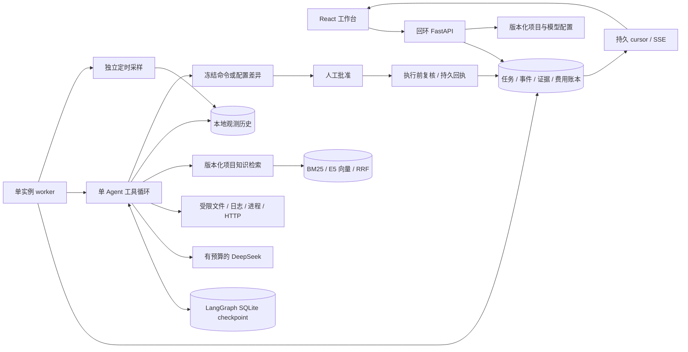

# 架构、取舍与一致性边界

## 任务与外部效果

API 只写入任务与决定，独立 worker 执行 Agent。关闭页面不会取消后台任务。worker 通过本机文件锁维持单实例；人工等待返回调度循环，不占活跃执行预算。模型配置、项目权限、知识 generation 和检索方式在提交时冻结。项目权限变更会使旧任务在执行边界停止；幂等重试返回原任务，显式改变冻结参数产生冲突。

app.db 保存任务、批准、快照、效果回执、持久事件和调用账本；graph.db 由官方 SQLite saver 管理。两库没有跨库事务，恢复时检查真实图状态并协调应用终态。对于本机文件与进程，checkpoint 不能实现外部效果 exactly-once：持久声明后结果不明返回 UNKNOWN，禁止自动重放。执行器核对批准摘要、文件摘要、PID 身份和监听归属；批准不等于执行完成，健康通过不等于业务恢复。

模型调用先持久预留次数与费用，再发送请求；没有用量的请求保留未知费用预留。模型、工具、活跃时间、单任务和累计费用均有上限。引用必须指向本任务实际取得的快照、匹配版本且包含原文摘录；最多两轮显式引用修正仍计入原预算，修正期间禁止提出新服务操作。

## 知识与运行证据

项目知识只来自操作者登记的 Markdown / 文本。读取受项目根目录、普通文件、路径、文档数、字节数和扫描时间约束，先脱敏再分块和嵌入。SQLite 保存不可变内容 generation 与可重用向量缓存。词法 BM25 在冻结 generation 内计算，其他项目新增语料不会改变旧 generation 的分数。

本地 E5 使用固定 revision、query/passage 前缀、384 维归一化向量和精确余弦排序；混合方式通过 RRF 融合并限制同文档重复。当前上限为 200 文档、4 MiB 源文本、2000 chunks。在此范围内，精确搜索和 SQLite 减少部署负担；需要更大规模时，再用实际数据证明独立向量数据库的必要性。向量依赖或模型缺失时明确返回词法降级，推理过程不自动下载模型。

知识片段的引用身份不包含查询分数和延迟，避免同一片段多次搜索产生快照冲突。知识是排查指导，不能替代日志、指标、业务探针等运行事实。旧固定案例的 FTS5 检索保留为合成回归路径，与真实项目命名空间隔离。

## 历史与业务可用性

独立采样任务每 10 秒读取登记的健康、指标和统计来源，记录在本机 observations.db；不会调用 LLM。历史默认保留 7 天，并限制行数和存储规模。返回结果记录开始采集时间、缺口、裁剪、降采样及最小样本条件。计数器重置不计算伪造的连续增量；稀疏样本不能支撑容量或因果结论。

业务探针只能执行操作者事先登记的固定请求、JSON 断言与可选延迟阈值。模型只选择是否检查以及有限尝试次数，不能构造任意 URL、请求体或写接口。当前 POST 仅支持固定 /query 的只读图查询。业务错误和健康 200 可以同时成立；两种结果分别保留。

## 分发和信任边界

前端与合成资源打包进 wheel，用户数据目录独立于源码目录和工作目录。运行时不写入 site-packages。备份要求停止应用并保留权限，包含恢复所需的版本化本机凭证；模型缓存通过固定 revision 重新下载，不进入备份。

支持一个操作系统账户、回环 HTTP、单 API/worker 和授权的本机进程。版本化凭证文件不是加密保险库，规则脱敏也不能保证发现所有秘密。日志与代码经工具取得后可能发送给配置的云模型；应登记允许发送的来源。多租户、公网、团队认证和高可用不在当前承诺内。

采用单 Agent 是为控制证据流、预算和审批边界。多 Agent、容器平台和更多存储服务需要具体业务问题与收益证据，不能替代真实取证和验收。
